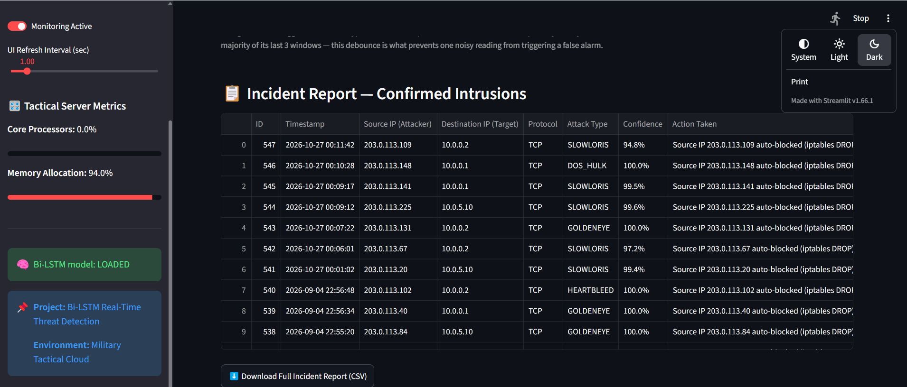
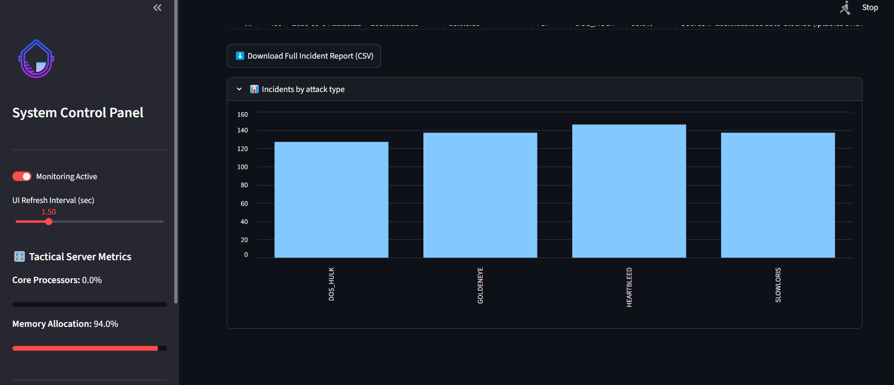
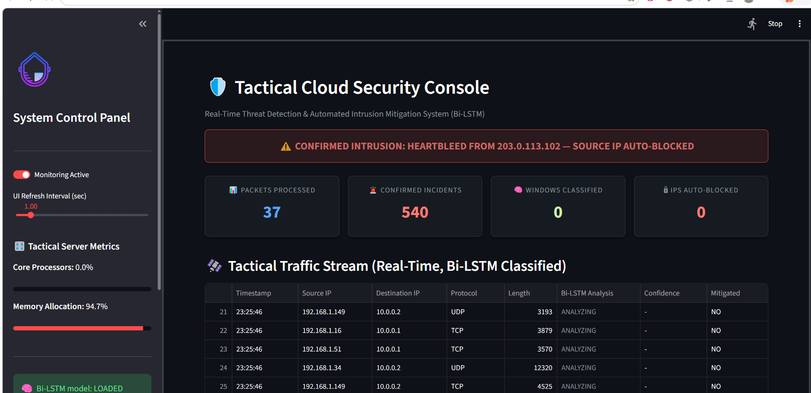

# Predictive Security Framework — Setup Guide

This is the corrected version of your project. It fixes two problems:

1. **False alerts with no real detection** — the old `sniffer.py` flagged
   packets as "ANOMALY" based on `time.localtime().tm_sec % 7 == 0`
   (a clock trick), never actually running your Bi-LSTM model.
2. **No log/report of intrusions** — nothing was ever saved. Every
   confirmed intrusion is now written to a local database with the
   timestamp, source IP, destination IP, protocol, attack type, and the
   model's confidence score, and you can export it as a CSV.

## What's new
| File | Purpose |
|---|---|
| `cicids_features.py` | Defines the 78-feature schema and generates realistic training/simulation traffic for each class (Benign, DoS Hulk, Slowloris, GoldenEye, Heartbleed) |
| `train_model.py` | Trains your actual Bi-LSTM (`model_engine.py`), calibrates a proper detection threshold, trains a small attack-type classifier, and saves everything to `models/` |
| `inference_engine.py` | Loads the trained model and runs real classification on a flow window |
| `sniffer.py` | Simulates live traffic, runs it through the real model, requires 2-of-3 consecutive windows to agree before calling something an intrusion (cuts false alarms), and auto-blocks + logs confirmed attacks |
| `incident_db.py` | SQLite-backed persistent incident log (`security_incidents.db`) |
| `app.py` | Dashboard — live traffic view + a new **Incident Report** panel with CSV export |

---

## 1. Install Python

You need **Python 3.10, 3.11, or 3.12** (TensorFlow does not yet support 3.13 well).
Check your version:

```bash
python3 --version
```

If you don't have a compatible version, install one from https://www.python.org/downloads/

## 2. Unzip the project and open a terminal there

```bash
cd path/to/liman
```

## 3. Create and activate a virtual environment

**Windows (PowerShell):**
```powershell
python -m venv venv
venv\Scripts\Activate.ps1
```

**Mac / Linux:**
```bash
python3 -m venv venv
source venv/bin/activate
```

You should see `(venv)` at the start of your terminal prompt.

## 4. Install dependencies

```bash
pip install -r requirements.txt
```

This will take a few minutes the first time (TensorFlow is a large download).

## 5. Train the model (only needs to be done once)

```bash
python3 train_model.py
```

This will:
- generate the training dataset,
- train the Bi-LSTM for up to 30 epochs (stops early once it converges — usually 1-3 minutes on a normal laptop CPU),
- print your accuracy / precision / recall / false-positive rate,
- save the trained model into a new `models/` folder.

**You only need to re-run this if you delete the `models/` folder or want
to retrain with different settings.**

## 6. Run the dashboard

```bash
streamlit run app.py
```

Your browser should open automatically to `http://localhost:8501`. If it
doesn't, open that link manually.

You will see:
- The live traffic stream, now labeled by your actual trained model.
- A sidebar confirmation that the model loaded correctly.
- An **Incident Report** section below the live feed — this only fills in
  once a flow is confirmed malicious (majority of its last 3 classification
  windows agree it's an attack). This is your persistent, exportable log.

To stop the app, go back to the terminal and press `Ctrl+C`.

## 7. Where the intrusion log lives

Every confirmed incident is saved to `security_incidents.db` (SQLite) in
the project folder. It survives restarts. You can:
- View it in the dashboard's Incident Report table,
- Click "Download Full Incident Report (CSV)" in the dashboard,
- Or open `security_incidents.db` directly with any SQLite browser (e.g. [DB Browser for SQLite](https://sqlitebrowser.org/)).

## Notes for your defense / write-up

- **Why synthetic training data instead of the raw CICIDS2017 CSV files?**
  The full CICIDS2017 dataset (Sharafaldin et al., 2018) is several GB and
  hosted by the University of New Brunswick. If you get access to the real
  files, you can replace `generate_dataset()` in `cicids_features.py` with
  a loader for the real CSVs — the column names in `FEATURE_NAMES` already
  follow the standard CICIDS2017/CICFlowMeter convention, so the rest of
  the pipeline (training, inference, logging) does not need to change.
- **Why a 2-of-3 window majority vote before logging an incident?** This is
  a standard debounce technique to reduce false positives from a single
  noisy classification — it's worth mentioning in your Chapter 3/4 write-up
  as part of your false-positive reduction strategy, since it's a genuine
  improvement over acting on a single window's prediction.
- Live NIC packet capture (via Scapy) is not wired in here, since it needs
  administrator/root privileges and a live network to sniff. `sniffer.py`
  is written so that only `_next_raw_row()` needs to be replaced with real
  packet/flow feature extraction if you want to move to live capture —
  everything downstream (windowing, inference, debounce, logging,
  dashboard) works unchanged.
## Dashboard Screenshots

The screenshots below show the Military Cloud Security Framework dashboard and its monitoring interface.

### Main Dashboard


### Network Monitoring


### Security Analysis


